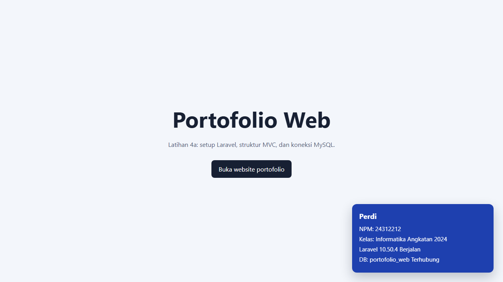

# Latihan 4a - Setup Laravel dan Koneksi MySQL

## Identitas

- Nama: Perdi
- NPM: 24312212
- Kelas: Informatika Angkatan 2024
- Branch: `Lat-4a_SetupLaravel`

## Screenshot

## Versi dan alasan pemilihan

- PHP 8.3.36: versi CLI yang digunakan saat pengujian.
- Laravel 10.50.4: dipilih karena memenuhi instruksi tugas, menyediakan `app/Http/Kernel.php`, dan langsung menyediakan `routes/api.php`.
- Composer 2.10.3: pengelola dependency PHP.
- MySQL: database aplikasi, menggunakan database `portofolio_web`.

## Menjalankan proyek

1. Nyalakan MySQL dari XAMPP atau Laragon.
2. Buat database bernama `portofolio_web` melalui phpMyAdmin atau MySQL client.
3. Pastikan konfigurasi lokal di `.env` memakai koneksi `mysql`, host `127.0.0.1`, port `3306`, user `root`, dan password sesuai instalasi lokal.
4. Jalankan `php artisan config:clear` setelah mengubah `.env`.
5. Jalankan `php artisan migrate`.
6. Jalankan `php artisan serve`, lalu buka http://127.0.0.1:8000.

Halaman root menampilkan welcome dan kartu identitas. Website portofolio utama tersedia di `/portfolio`.

## Struktur folder penting

- `app/Http/Controllers`: menerima request, mengoordinasikan model, dan menentukan response.
- `app/Models`: model Eloquent untuk data aplikasi dan relasi database.
- `bootstrap/app.php`: membuat instance aplikasi dan menghubungkan kernel HTTP/console.
- `config`: konfigurasi aplikasi, database, mail, dan portofolio.
- `database/migrations`: definisi perubahan skema tabel secara terurut.
- `public`: document root web server dan front controller `index.php`.
- `resources/views`: template Blade untuk welcome dan halaman portofolio.
- `routes`: definisi route web, API, dan console.
- `storage`: log, cache, session, dan file yang dihasilkan aplikasi.
- `.env`: konfigurasi lokal dan rahasia; file ini tidak boleh masuk Git. `.env.example` berisi template aman.

## Perintah Artisan

| Perintah | Fungsi |
| --- | --- |
| `php artisan serve` | Menjalankan server lokal. |
| `php artisan migrate` | Menjalankan migration yang belum diterapkan. |
| `php artisan migrate:fresh` | Menghapus semua tabel lalu menjalankan ulang migration; gunakan hanya pada database yang boleh dihapus. |
| `php artisan make:model Project` | Membuat model Eloquent. |
| `php artisan make:controller ProjectController` | Membuat controller. |
| `php artisan make:migration create_projects_table` | Membuat file migration. |
| `php artisan make:seeder ProjectSeeder` | Membuat seeder. |
| `php artisan db:seed` | Menjalankan seeder utama. |
| `php artisan route:list` | Menampilkan route yang terdaftar. |
| `php artisan config:clear` | Membersihkan konfigurasi yang tercache, terutama setelah mengubah `.env`. |

Jangan menjalankan `php artisan config:cache` di lingkungan lokal untuk latihan ini. `APP_KEY` sudah tersedia; jangan membuat ulang kecuali benar-benar diperlukan.

## Pengumpulan

- Repository: https://github.com/perdi24312212-web/portolio
- Branch: https://github.com/perdi24312212-web/portolio/tree/Lat-4a_SetupLaravel
- Pastikan repository publik dan `.env` tidak ikut dikirim.
- Masukkan tautan repository dan branch ke tab `Lat-4a_SetupLaravel` pada spreadsheet pengumpulan.
