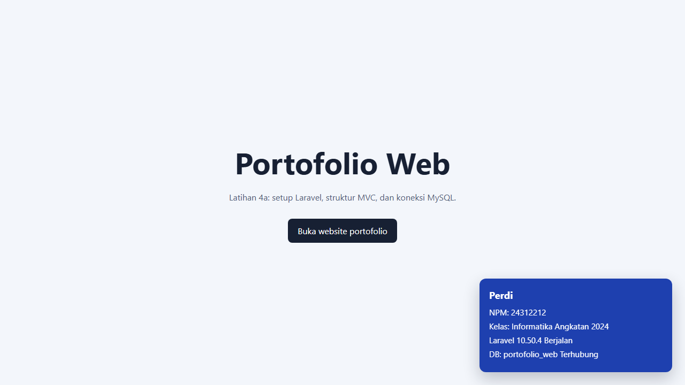

<div align="center">

# Perdi — Personal Portfolio

Portofolio pribadi berbasis Laravel untuk menampilkan profil, keahlian, proyek, dan pengalaman.

[](https://laravel.com/)
[](https://www.php.net/)
[](https://www.mysql.com/)

</div>

## Tentang proyek

Proyek ini dibuat sebagai latihan setup Laravel dan koneksi MySQL, sekaligus sebagai website portofolio. Halaman utama Laravel ada di `/`, sedangkan website portofolio ada di `/portfolio`.

### Fitur

- Halaman portofolio responsif.
- Endpoint API untuk profil, keahlian, proyek, pengalaman, dan sertifikat.
- Model Eloquent dan migration untuk mengelola struktur data.
- Konfigurasi database lokal melalui file `.env`.

> **Catatan data:** migration dan model database tersedia di repository, tetapi database MySQL beserta isinya tidak disimpan di GitHub. Halaman `/portfolio` saat ini membaca konten dari `config/portfolio.php`. Beberapa endpoint API mengambil data dari database, sementara sebagian lainnya masih membaca konfigurasi tersebut.

## Screenshot



## Teknologi

| Teknologi | Versi / penggunaan |
| --- | --- |
| PHP | 8.3.36 saat pengujian |
| Laravel | 10.50.4 |
| Composer | 2.10.3 |
| MySQL | Database lokal, nama database `portofolio_web` |

## Menjalankan secara lokal

### Persyaratan

- PHP 8.1 atau lebih baru dan ekstensi PHP yang dibutuhkan Laravel.
- Composer.
- MySQL, misalnya dari XAMPP atau Laragon.

### Langkah

1. Clone repository dan masuk ke folder proyek.
2. Pasang dependency PHP:

   ```bash
   composer install
   ```

3. Siapkan file `.env` dari `.env.example` jika belum tersedia, lalu atur koneksi database:

   ```env
   DB_CONNECTION=mysql
   DB_HOST=127.0.0.1
   DB_PORT=3306
   DB_DATABASE=portofolio_web
   DB_USERNAME=root
   DB_PASSWORD=
   ```

   Sesuaikan nama database, username, dan password dengan instalasi MySQL kamu. Buat database `portofolio_web` terlebih dahulu melalui phpMyAdmin atau MySQL client.

4. Buat application key, bersihkan cache konfigurasi, dan jalankan migration:

   ```bash
   php artisan key:generate
   php artisan config:clear
   php artisan migrate
   ```

5. Jalankan server lokal:

   ```bash
   php artisan serve
   ```

6. Buka `http://127.0.0.1:8000` atau `http://127.0.0.1:8000/portfolio`.

## API

Endpoint API portofolio tersedia di:

| Method | Endpoint |
| --- | --- |
| `GET` | `/api/portfolio/profile` |
| `GET` | `/api/portfolio/skills` |
| `GET` | `/api/portfolio/projects` |
| `GET` | `/api/portfolio/projects/{slug}` |
| `GET` | `/api/portfolio/experiences` |
| `GET` | `/api/portfolio/certificates` |

## Struktur penting

| Folder / file | Keterangan |
| --- | --- |
| `app/Http/Controllers` | Controller halaman dan API |
| `app/Models` | Model Eloquent |
| `config/portfolio.php` | Data konten portofolio yang digunakan halaman utama |
| `config/database.php` | Konfigurasi koneksi database Laravel |
| `database/migrations` | Definisi tabel dan relasi database |
| `resources/views` | Template halaman Blade |
| `routes` | Route web dan API |

## Identitas tugas

- **Nama:** Perdi
- **NPM:** 24312212
- **Kelas:** Informatika Angkatan 2024
- **Branch:** `Lat-4a_SetupLaravel`
- **Repository:** [perdi24312212-web/portolio](https://github.com/perdi24312212-web/portolio)

Jangan unggah file `.env` atau kredensial database ke repository. Gunakan `.env.example` hanya sebagai template tanpa password atau rahasia.
